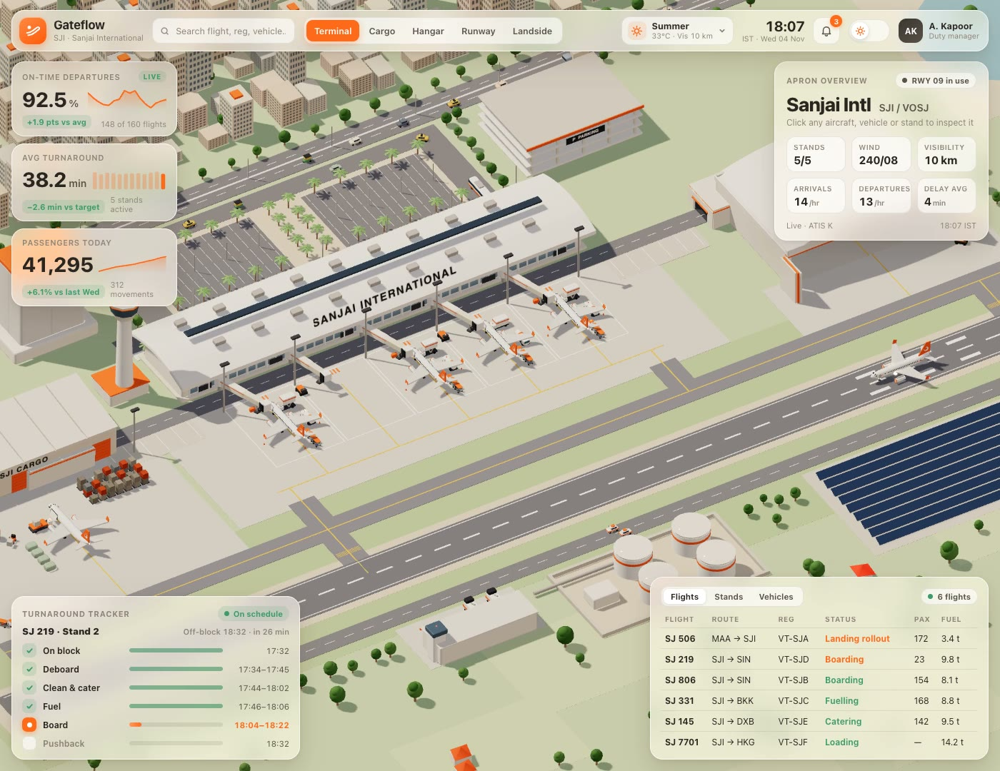

# Worlds

Three living 3D worlds that play like strategy games. Claude built each one from a single prompt, as one HTML file with three.js. Nothing is a 3D model: every building, plane, fire truck and lantern is code.

| | World | Built from |
|---|---|---|
|  | **[Gateflow](https://felixo-gif.github.io/worlds/gateflow/)**: airport apron control. Two A320s land, turn around, get pushed back and take off while tugs, fuel trucks and catering trucks give way. | [gateflow/PROMPT.md](gateflow/PROMPT.md) |
|  | **[Siren](https://felixo-gif.github.io/worlds/siren/)**: emergency response city. Incidents pop up, the nearest unit is dispatched, traffic pulls aside, crews put the fire out. | [siren/PROMPT.md](siren/PROMPT.md) |
|  | **[Talad](https://felixo-gif.github.io/worlds/talad/)**: a Bangkok night market. Shoppers queue at the grills, tuk-tuks load up, the skytrain stops overhead, lanterns rise on Loy Krathong. | [talad/PROMPT.md](talad/PROMPT.md), made from [TEMPLATE.md](TEMPLATE.md) |

Click a name to open the world live in your browser. Drag to pan, right-drag to rotate, scroll to zoom, click anything to follow it, and try the weather menu and the day/night toggle.

## Build your own
1. Copy a `PROMPT.md`, or fill in [TEMPLATE.md](TEMPLATE.md) with your own place.
2. Paste it into Claude. Opus 5.5 gives the best first build.
3. Open the HTML file it writes in your browser, then ask for changes.

Every prompt has the same five blocks: **World** (what exists), **Life** (what moves on its own), **Interaction** (click and follow), **Dashboard** (the glass panels and live data) and **Extras** (weather and day/night).

## Credits
The prompt format, the Gateflow and Siren prompts and the blank template come from the free **World Prompt Pack** by [@sanjai.builds](https://www.instagram.com/sanjai.builds/), which has 17 worlds in all. The Talad prompt and all the code here were written for this repo. Each world runs offline: `three.js` (MIT, three.js authors) sits next to it.

Code: MIT, see [LICENSE](LICENSE). Made by [@felixhmohr](https://www.instagram.com/felixhmohr/).
